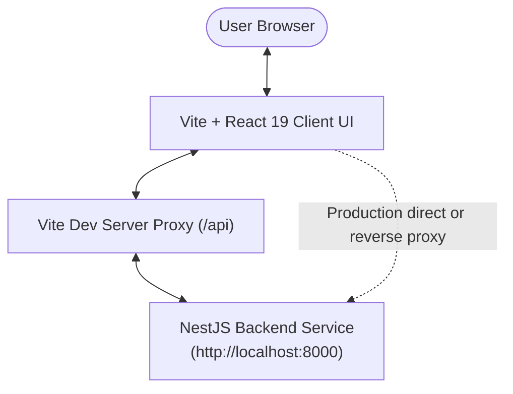

# Scientific Literature RAG - Frontend Client

[](https://vite.dev/)
[](https://react.dev/)
[](https://tailwindcss.com/)
[](https://www.typescriptlang.org/)

Modern, ultra-fast web interface built with **Vite**, **React 19**, and **Tailwind CSS v4** for exploring, querying, and interacting with the Scientific Literature RAG System.

---

## 🌟 Features

- **Interactive Academic Chat**: Ask research questions and receive answers grounded in over 913,000+ scientific chunks.
- **Deep Citation Inspector**: View inline citations with direct links to referenced papers, confidence metrics, and author details.
- **Data Mining Visualizer**: Inspect PageRank authority indicators and retrieval metrics (cosine similarity vs. authority boost).
- **Responsive & Dark-Mode Ready**: Fully responsive user experience built with Tailwind CSS v4 design tokens and anti-slop typography.
- **Vite Fast HMR**: Instant Hot Module Replacement and lightning-fast developer experience.

---

## 🏗️ Architecture & Component Flow



---

## 📂 Project Structure

```text
frontend_rag/
├── public/                 # Static assets & brand vectors (favicon, SVGs)
├── src/
│   ├── components/         # Modular UI Components
│   │   ├── ChatPanel.tsx          # Chat thread, Markdown & KaTeX rendering, sample queries
│   │   ├── GroundedInspector.tsx  # Grounded chunks sidebar inspector
│   │   ├── Navbar.tsx             # System telemetry badges, model info & theme toggle
│   │   └── PaperModal.tsx         # Detailed paper inspect modal (arXiv / OpenAlex)
│   ├── context/
│   │   └── ThemeContext.tsx       # Dark & Light theme state provider
│   ├── types/
│   │   └── rag.ts                 # TypeScript interfaces for queries, chunks, & telemetry
│   ├── App.tsx             # Root application orchestrator
│   ├── index.css           # Tailwind CSS v4 & KaTeX styles, theme variables
│   ├── main.tsx            # DOM root bootstrap
│   └── vite-env.d.ts       # Vite client types & environment interface
├── Dockerfile              # Multi-stage production container (Vite build -> Nginx)
├── index.html              # Single page entry HTML
├── package.json            # Scripts and dependencies (Vite, React 19, Tailwind CSS v4)
├── tsconfig.json           # TypeScript configuration
└── vite.config.ts          # Vite build, plugins (@tailwindcss/vite, @vitejs/plugin-react), & dev proxy
```

---

## ⚡ Getting Started

### 1. Requirements
- **Node.js**: v20+ (v22 LTS recommended)
- **npm**, **pnpm**, or **yarn**
- Running instance of the `backend_rag` service (default: `http://localhost:8000`)

### 2. Environment Configuration (Optional)
By default, Vite's dev server proxies `/api` to `http://localhost:8000`. You can customize this in `.env`:

```bash
VITE_BACKEND_URL=http://localhost:8000
# Or direct API URL for production:
# VITE_API_URL=http://localhost:8000
```

### 3. Installation & Development

```bash
# Install dependencies
npm install

# Run development server with Vite (starts on http://localhost:3000)
npm run dev
```

Open [http://localhost:3000](http://localhost:3000) in your browser to view the application.

---

## 🚀 Build & Production

```bash
# Type check and build production bundle into dist/
npm run build

# Preview production build locally
npm run preview

# Lint codebase
npm run lint
```
