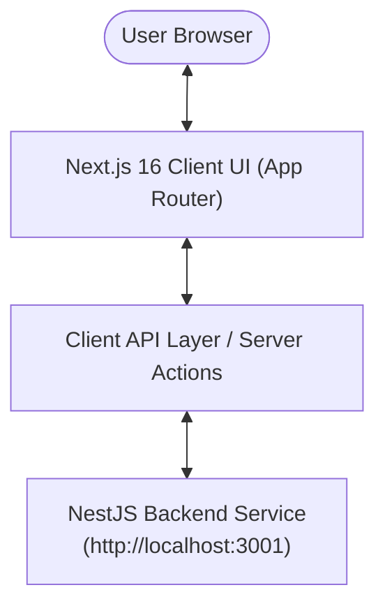

# Scientific Literature RAG - Frontend Client

[](https://nextjs.org/)
[](https://react.dev/)
[](https://tailwindcss.com/)
[](https://www.typescriptlang.org/)

Modern, high-performance web interface built with **Next.js 16 (App Router)**, **React 19**, and **Tailwind CSS v4** for exploring, querying, and interacting with the Scientific Literature RAG System.

---

## 🌟 Features

- **Interactive Academic Chat**: Ask research questions and receive streaming answers grounded in over 13,000+ scientific papers.
- **Deep Citation Inspector**: View inline citations with direct links to referenced papers, confidence metrics, and author details.
- **Data Mining Visualizer**: Inspect PageRank authority indicators and related research topics derived from co-authorship networks.
- **Responsive & Dark-Mode Ready**: Fully responsive user experience built with Tailwind CSS v4 and optimized Geist typography.

---

## 🏗️ Architecture & Component Flow



---

## 📂 Project Structure

```text
frontend_rag/
├── app/
│   ├── favicon.ico       # Application icon
│   ├── globals.css       # Tailwind CSS v4 directives & theme styles
│   ├── layout.tsx        # Root layout with HTML metadata & font providers
│   └── page.tsx          # Main RAG chat & exploration interface
├── public/               # Static assets & brand vectors
├── .gitignore            # Git ignore specification
├── eslint.config.mjs     # ESLint configuration
├── next.config.ts        # Next.js build and routing options
├── package.json          # Dependencies and script definitions
└── tsconfig.json         # TypeScript compiler options
```

---

## ⚡ Getting Started

### 1. Requirements
- **Node.js**: v20+ (v22 LTS recommended)
- **npm**, **pnpm**, or **yarn**
- Running instance of the `backend_rag` service (default: `http://localhost:3001`)

### 2. Environment Configuration
Create a `.env.local` file in the `frontend_rag` directory:

```bash
NEXT_PUBLIC_API_URL=http://localhost:3001
```

### 3. Installation & Development

```bash
# Install dependencies
npm install

# Run development server with Turbopack
npm run dev
```

Open [http://localhost:3000](http://localhost:3000) in your browser to view the application.

---

## 🚀 Build & Production

```bash
# Build production bundle
npm run build

# Start production server
npm run start

# Lint codebase
npm run lint
```
