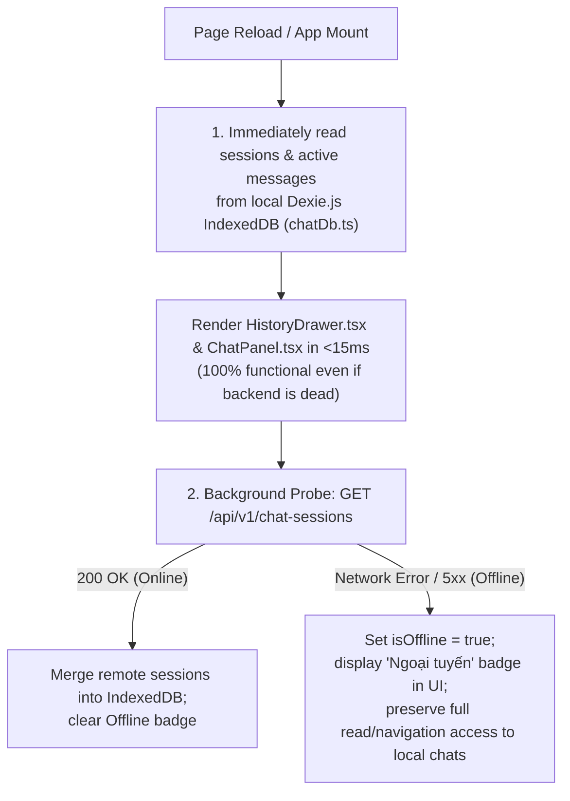

# STATE_AND_STREAMING_ARCHITECTURE.md — Frontend Offline-First State, IndexedDB Sync & SSE Streaming

- **Motivation/Background**: `frontend_rag` must simultaneously maintain a 100+ FPS 3D WebGL scene (`WorldCanvas.tsx`) while streaming live scientific RAG answers containing LaTeX math (`KaTeX`) and interactive `[Paper: id]` citations, AND guarantee that all past chat sessions remain 100% viewable and navigable even if `backend_rag` goes completely offline (`D-005`, `D-017`). AI agents modifying frontend state, API calls, or chat components must understand how `useSessionStore`, `useRagStore`, `Dexie.js`, and deferred Markdown rendering cooperate.
- **Purpose**: Document the client-side state architecture (`Zustand` + `Dexie.js`), the Cache-First offline synchronization protocol with `/api/v1/chat-sessions`, and the `30ms` micro-batched SSE token streaming pipeline.
- **Overview Pipeline**: App Boot → `useSessionStore.hydrate()` from `Dexie.js` (`chatDb.ts`) + Non-Blocking Background Sync (`/api/v1/chat-sessions`) → User Prompt → Local UUIDv7 Session/Message Commit → `useRagStore` SSE Stream (`/api/v1/rag/chat/stream`) → `30ms` Token Buffer → `useDeferredValue` (`Markdown.tsx`) + 3D `TopKThreads` Activation.
- **Detailed Plan**: Section 1 details the `Dexie.js` IndexedDB Schema & Cache-First Invariants; Section 2 explains `useSessionStore` Multi-Turn Lifecycle & Offline Resilience; Section 3 covers `useRagStore` SSE Streaming & `30ms` Micro-Batching; Section 4 documents Deferred Markdown, KaTeX & 3D Camera Synchronization.
- **References**: [../AGENTS.md](../AGENTS.md), [../../AGENTS.md](../../AGENTS.md), [perf-chat-report.md](perf-chat-report.md), [perf-report.md](perf-report.md), [../../docs/AI_chat_log/Vuong_chat_logs.md](../../docs/AI_chat_log/Vuong_chat_logs.md).
- **Created**: 2026-10-29T19:47:00+07:00
- **Last Updated**: 2026-10-29T19:47:00+07:00

[STATUS: ACTIVE]

---

## 1. Client-Side IndexedDB Schema (`src/db/chatDb.ts`)

Per `D-017`, `frontend_rag` never relies solely on in-memory Zustand state or `localStorage` (which blocks the main thread on JSON serialization and hits a `5 MB` ceiling). Instead, [`src/db/chatDb.ts`](../src/db/chatDb.ts) uses **Dexie.js** over browser IndexedDB with two primary tables keyed by RFC 9562 **UUIDv7** strings ([`src/utils/uuid.ts`](../src/utils/uuid.ts)):

| IndexedDB Table | Primary Key & Indexes | Stored Fields |
| :--- | :--- | :--- |
| `sessions` | `id` (UUIDv7), `updatedAt`, `createdAt` | `id`, `title` (auto-sliced from first prompt: `firstQuery.trim().slice(0, 48)`), `messageCount`, `createdAt`, `updatedAt`, `lastMessagePreview`, `syncedWithBackend` |
| `messages` | `id` (UUIDv7), `sessionId`, `[sessionId+createdAt]` | `id`, `sessionId`, `role` (`'user' \| 'assistant'`), `content`, `citations` (`Citation[]`), `timings`, `confidence`, `createdAt` |

### Why UUIDv7 on Both Client and Server?
Because UUIDv7 embeds a 48-bit millisecond Unix timestamp in its most significant bits, IDs generated offline in the browser sort identically by creation time (`_id` lexicographical order = chronological order) when later synchronized with MongoDB `chat_sessions` and `chat_messages` in `backend_rag`.

---

## 2. `useSessionStore` — Cache-First Persistence & Offline Resilience

[`src/store/sessionStore.ts`](../src/store/sessionStore.ts) orchestrates session switching, creation, auto-titling, deletion, and background server synchronization:

### Key UX & State Invariants in [`HistoryDrawer.tsx`](../src/components/chat/HistoryDrawer.tsx)
1. **`+ Đoạn chat mới` (`+ New Chat`)**: Creates or switches to a clean draft session state; the session record is committed and auto-titled (`firstQuery.trim().slice(0, 48)`) the moment the user submits their first prompt.
2. **2-Step Trash Delete Confirmation (`Xóa?` / `Huỷ`)**: Clicking the trash icon next to any session opens an inline confirmation before deleting the session and its messages from `Dexie.js` and issuing a background `DELETE /api/v1/chat-sessions/:id` (soft-delete on backend).
3. **Offline Badge (`Ngoại tuyến`)**: Whenever `backend_rag` is unreachable, the UI clearly informs the user via the `Ngoại tuyến` indicator while allowing them to browse every historical session, inspect paper citations, and read rendered LaTeX formulas offline.

---

## 3. `useRagStore` — SSE Streaming & `30ms` Micro-Batching (`D-005`)

When the user submits a query in [`ChatPanel.tsx`](../src/components/chat/ChatPanel.tsx), [`src/store/ragStore.ts`](../src/store/ragStore.ts) manages the active flight and Server-Sent Events (SSE) stream from `POST /api/v1/rag/chat/stream`:

1. **`meta` Event (Immediate Retrieval Feedback)**:
   - As soon as Qdrant vector search and PageRank/FP-Growth mining finish (`~50–150ms`), `backend_rag` emits the `meta` SSE frame containing `citations`, `threads` (3D coordinates), and `retrieval_ms`.
   - `useRagStore` immediately updates the 3D scene state so [`TopKThreads.tsx`](../src/components/world/fx/TopKThreads.tsx) draws glowing connection arcs from the query node to the cited papers in the 3D Knowledge Tree while the LLM is still generating tokens.
2. **`token` Events (`30ms` Micro-Batch Buffer)**:
   - Raw SSE token events can arrive every `5–15ms`. Updating React state on every single token would trigger 60–100 full React re-renders per second.
   - `ragStore.ts` accumulates incoming token strings inside a mutable buffer and flushes them to Zustand state at most once every **`30ms`** (`~33 Hz`), cutting React reconciliation overhead by `>65%`.
3. **`done` Event (Final Commit)**:
   - Flushes any remaining buffered tokens, records final LLM generation timings, and commits the completed assistant message (with `citations` and `timings`) into `Dexie.js` (`chatDb.ts`).

---

## 4. Deferred Markdown & KaTeX Rendering (`src/components/chat/Markdown.tsx`)

Even with `30ms` token batching, parsing a 1,500-word response containing complex LaTeX equations (`$$ ... $$`) through `remark-math` and `rehype-katex` takes `8–15ms` on the CPU. If executed synchronously during high-priority renders, it causes frame drops in the `100+ FPS` WebGL `<Canvas>`.

[`src/components/chat/Markdown.tsx`](../src/components/chat/Markdown.tsx) prevents main-thread blocking via three techniques (`D-005`, `D-014`):
1. **`useDeferredValue(content)`**: Tells React 19 to treat Markdown/KaTeX AST re-parsing as a low-priority concurrent transition that yields immediately to WebGL `requestAnimationFrame` ticks and user input events.
2. **Component-Scoped KaTeX CSS Import**: `katex/dist/katex.min.css` is imported inside `Markdown.tsx` rather than the global `index.css`, slashing initial critical CSS blocking time by `50%` and helping achieve **Lighthouse `97 / 100` (`FCP = 0.9s`, `LCP = 1.0s`)**.
3. **Interactive Citation Pills**: Custom regex/AST transforms convert `[Paper: <paper_id>]` markers into clickable badges that focus the 3D camera directly on that paper's node in [`WorldCanvas.tsx`](../src/components/world/WorldCanvas.tsx).
