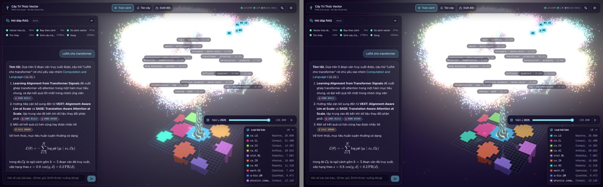
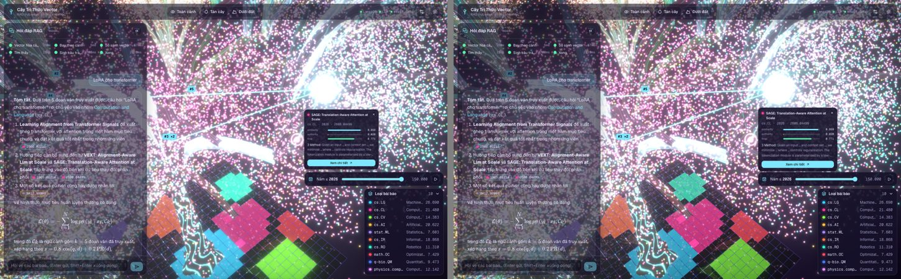
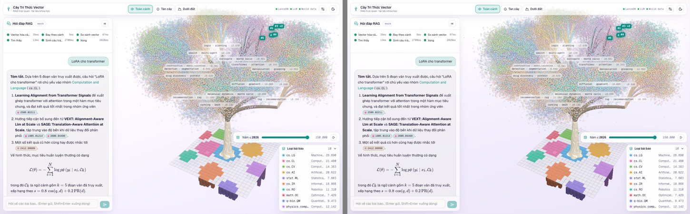
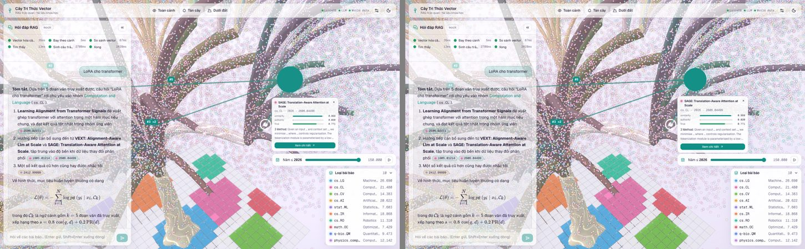
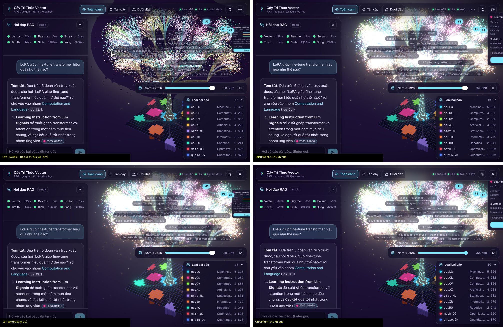

# Báo cáo tối ưu hiệu năng scene

Tiếp nối `docs/trig-audit.md`, vốn chỉ ra lag nằm ở bloom/overdraw, raycast và `diffStates` chứ không ở lượng giác. Ngày đo: 2026-10-19.

## 1. Điều kiện đo

| | |
| :-- | :-- |
| Bản build | `npm run build` → `npx vite preview --port 4173` (production), URL `/?vectors=150000&bench` |
| Máy | Apple M4 (CPU 10 nhân, **GPU tích hợp 8 nhân**, RAM 16 GB), macOS 26.5.2 — Chromium headless 156 qua ANGLE/Metal, 1440×900, dpr 1, `--disable-gpu-vsync --disable-frame-rate-limit` |
| Kịch bản | Gửi câu hỏi → bỏ qua animation → giai đoạn `done` (quả cầu đang thở, ô đất nhấp sáng, top-k sáng) → camera `overview`, chờ 3 s |
| Frame time (A) — rAF | Khoảng cách `requestAnimationFrame` trên 600 frame (bỏ 20 frame đầu): median và p95. Mỗi theme đo 3 lần, lấy median của các lần |
| Frame time (B) — đồng bộ | Như (A) nhưng mỗi frame gọi `readPixels` 1 pixel (`SYNC=1`), buộc GPU vẽ xong frame trước. Đo **đủ** chi phí GPU (kể cả khi GPU chạy chậm hơn CPU); có cộng độ trễ readback nên là **cận trên** |
| A/B trong cùng bản build | `?legacyfx` dựng lại đúng cấu hình GPU cũ (composer MSAA 4×, canvas AA, không FXAA, bloom ngưỡng 0.18/0.75 và cường độ 1.35/0.35, sprite đủ kích thước, không discard theo alpha). Số draw call của chế độ này khớp bản cũ (51.7 / 50.6) |
| Draw call | `renderer.info.render.calls` cộng dồn 10 frame ÷ 10 (gồm cả các pass hậu kỳ) |
| Raycast | Thời gian hàm `pick` (`perfProbe`) qua 60 vị trí chuột cố định trên tán, cách nhau 40 ms (lớn hơn throttle 30 ms) |
| diffStates | Thời gian cập nhật state điểm (`perfProbe`) khi bật/tắt lọc theo loại 20 lần (lọc ↔ bỏ lọc, mỗi lần ~135k điểm đổi trạng thái hiển thị) |
| Chất lượng | Bản "sau" ghim ở **Cao** (tier 0) để so sánh công bằng; bản "trước" không có bậc chất lượng |

`performance.now()` ở bản build (trang không cross-origin isolated) bị làm tròn 0.1 ms, nên frame time có bước 0.1 ms. Script đo: `scripts/perf-measure.cjs`; số liệu thô: `docs/perf-shots/raw/perf-{before,after}.json`.

## 2. Kết quả (150.000 vector, Apple M4)

**Vì sao có hai cách đo frame time.** Khi tắt vsync, Chromium có thể gọi `requestAnimationFrame` nhanh hơn tốc độ GPU vẽ thật (bỏ frame), nên (A) không đo hết chi phí GPU. Kiểm tra chéo cho thấy cùng một bản build, (A) cho 2.6 ms còn (B) cho 7.6 ms. Bảng (B) là số đáng tin cho phần GPU; bảng (A) giữ lại vì đó là số đo bản build cũ thật (trước khi sửa code).

### 2a. Frame time đồng bộ (B) — A/B cùng bản build (sau khi sửa lỗi FXAA, §7)

| Hạng mục | Theme | Trước (`?legacyfx`) | Sau | Thay đổi |
| :-- | :-- | --: | --: | :-- |
| Frame time median | Dark | 12.7 ms | **8.0 ms** | −37% |
| Frame time p95 | Dark | 17.3 ms | **13.7 ms** | −21% |
| Frame time median | Light | 13.3 ms | **8.9 ms** | −33% |
| Frame time p95 | Light | 18.4 ms | **13.7 ms** | −26% |
| Draw call / frame | Dark / Light | 51.7 / 50.6 | 49.5 / 48.4 | −2.2 |

### 2b. Đo rAF (A) — bản build cũ thật vs bản mới (đo khi còn FXAA, chỉ để tham khảo)

| Hạng mục | Theme | Trước | Sau | Thay đổi |
| :-- | :-- | --: | --: | :-- |
| Frame time median | Dark | 6.10 ms | **2.60 ms** | −57% |
| Frame time p95 | Dark | 7.80 ms | **5.20 ms** | −33% |
| Frame time median | Light | 7.90 ms | **2.80 ms** | −65% |
| Frame time p95 | Light | 10.60 ms | **7.30 ms** | −31% |
| Draw call / frame | Dark | 51.7 | 49.5 | −2.2 |
| Draw call / frame | Light | 50.6 | 48.4 | −2.2 |
| Raycast hover (trung bình) | Dark | 2.10 ms | **0.165 ms** | ÷12.7 |
| Raycast hover (p95) | Dark | 3.0 ms | 0.5 ms | |
| Raycast hover (trung bình) | Light | 5.95 ms | **0.34 ms** | ÷17.5 |
| diffStates (trung bình / tối đa) | Dark | 6.18 / 7.6 ms | **0.22 / 1.6 ms** | ÷28 |
| diffStates (trung bình / tối đa) | Light | 14.27 / 18.0 ms | **0.53 / 3.2 ms** | ÷27 |

Microbenchmark CPU (Node, `npm run bench` → `src/utils/perf.bench.ts`, 150k vector):

| Đoạn | Cũ | Mới | |
| :-- | --: | --: | :-- |
| Raycast một tia | `THREE.Points.raycast` 1.20 ms | lưới không gian 0.022 ms | nhanh hơn 56× |
| Đổi lọc loại A → loại B | `diffStates` + `applyStates` 2.31 ms | cập nhật mask 0.27 ms | nhanh hơn 8.6× |
| Một bước "so sánh" của animation (overlay 30 mục) | 0.65 ms | 0.0002 ms | nhanh hơn ~2600× |

**Về draw call:** chỉ giảm ~2/frame (bloom 8 → 7 mức mipmap, bỏ MSAA resolve). Phần lớn thời gian tiết kiệm được **không đến từ số draw call** mà từ **fill-rate**: bỏ MSAA 4× trong composer, bloom chạy ở ½ độ phân giải, và mỗi sprite vẽ ít fragment hơn. Điều này khớp với kết luận của `trig-audit.md`.

## 3. Đã thay đổi gì

| # | Hạng mục | Thay đổi | File |
| :-- | :-- | :-- | :-- |
| 1 | Bloom | `EffectComposer multisampling={0}`, **không** dùng FXAA (xem §7); canvas `antialias: false`, `alpha: false` (vì composer vẽ off-screen, MSAA của canvas là lãng phí) | `components/world/PostFX.tsx`, `WorldCanvas.tsx` |
| 1 | Bloom | `mipmapBlur`, `resolutionScale 0.5` (tier 2: 0.25, 5 mức) | `PostFX.tsx` |
| 1 | Bloom | Ngưỡng sáng dark 0.18 → **0.42**, light 0.75 → **0.82** (nền ô đất mờ, ánh sáng phụ không còn bloom); cường độ dark giữ 1.35, light 0.35 → 0.45 | `theme/tokens.ts` |
| 2 | Điểm sáng | Không rasterise đuôi quầng (bán kính > 80%, alpha < 6%): diện tích sprite còn 64%; `discard` thêm fragment có alpha < 0.012; điểm focus giữ đủ vòng ngoài; kích thước tối đa 48 px; vẫn `depthWrite: false`, additive (dark) / normal (light) | `canopy/canopyShader.ts` |
| 3 | Chất lượng thích ứng | `PerformanceMonitor` + `AdaptiveDpr` (drei), bắt đầu theo dõi sau 5 s khởi động, chỉ hạ bậc dưới ~30 FPS (màn 60 Hz) / ~45 FPS (120 Hz). Thang bậc: **0** đầy đủ → **1** dpr 1.5 → **2** dpr 1 + bloom ¼ độ phân giải → **3** tắt hậu kỳ; tự lên bậc lại khi FPS hồi phục, sau 4 lần chập chờn thì đứng ở bậc 2. AdaptiveDpr hạ dpr khi đang xoay/zoom camera (`performance.regress()` từ sự kiện `control` của CameraControls) | `world/AdaptiveQuality.tsx`, `CameraDirector.tsx`, `store/uiStore.ts` |
| 3 | UI | Cài đặt → **Chất lượng: Tự động / Cao / Thấp**, kèm bậc đang dùng. "Thấp" = bậc 2 (giữ phát sáng nhưng rẻ) | `layout/SettingsPanel.tsx` |
| 4 | Raycast | Lưới không gian (ô 3 đơn vị, dạng CSR) dựng một lần; tia đi qua các ô bằng 3D-DDA, kiểm tra ô lân cận trong phạm vi threshold; tái sử dụng mảng kết quả. Vẫn throttle 30 ms. Test: **cùng tập điểm trúng** với `THREE.Points.raycast` trên 40 tia ngẫu nhiên | `utils/spatialGrid.ts`, `canopy/VectorCanopy.tsx` |
| 5 | diffStates | Bộ lọc chuyển thành mask `inFilter` (Uint8) + uniform `uFilter`: đổi lọc chỉ ghi chỉ số của lựa chọn cũ ∪ mới; overlay chỉ diff theo key; vùng upload gộp bằng `toUpdateRanges`. Test: kết quả hiển thị **bằng đúng** `diffStates` cũ trên 60 bước ngẫu nhiên | `utils/canopyUpdate.ts`, `VectorCanopy.tsx` |

`diffStates`/`applyStates` cũ được giữ lại làm tham chiếu cho test tương đương. Hành vi không đổi: 85/85 unit test pass (79 cũ + 6 mới), 6/6 E2E pass. Thẻ kết quả (ResultCard) thu nhỏ theo khoảng cách nhưng không dưới 85% để luôn đọc được.

## 4. Máy GPU yếu

**Không có máy GPU tích hợp kiểu laptop Intel/AMD để đo.** Máy duy nhất là Apple M4 (GPU tích hợp trong SoC, nhưng mạnh). Để có một điểm đo "GPU rất yếu", mình chạy bản build trên **SwiftShader** (WebGL giả lập hoàn toàn bằng CPU qua `--use-angle=swiftshader`, cùng máy M4, cùng 150k vector, theme dark, 140 frame). Mục đích chính là kiểm chứng thang chất lượng tự động; đây **không** phải số đo của một laptop thật.

Phép đo đồng bộ (B), 800×500 (1440×900 trên SwiftShader mất hàng chục phút cho một lượt), dpr 1, theme dark, 40 frame, 1 lần mỗi cấu hình:

| Cấu hình | Bậc khi đo | Frame time median | p95 | Draw call |
| :-- | :-: | --: | --: | --: |
| Trước (`?legacyfx`) | — | 189.2 ms (~5 FPS) | 202.7 ms | 51.7 |
| Sau · Cao | 0 | **113.4 ms** (−40%) | 121.0 ms | 49.5 |
| Sau · Thấp | 2 | **108.9 ms** (−42%) | 327.6 ms | 45.1 |
| Sau · Tự động | tự hạ 0 → 2/3 | **82.9 ms** (−56%) | 151.8 ms | 39.6 |

Nhận xét:
- Mức giảm 40% ở chất lượng Cao **khớp với M4** (−40%): lợi ích đến từ fill-rate nên giữ được cả trên GPU yếu.
- "Thấp" gần như bằng "Cao" ở đây: dpr vốn đã là 1, và trên rasteriser phần mềm thì phần đắt nhất là vẽ 150k sprite chứ không phải bloom.
- "Tự động" là nhanh nhất vì PerformanceMonitor tiếp tục hạ xuống bậc 3 (tắt hậu kỳ). Draw call trung bình 39.6 nằm giữa bậc 2 (45) và bậc 3 cho thấy nó chập chờn giữa hai bậc trong lúc đo; nếu chập chờn quá 4 lần thì `onFallback` khoá ở bậc 2 (chưa quan sát trực tiếp trong lượt đo ngắn này).
- p95 của "Thấp"/"Tự động" có đỉnh 150–330 ms. Lúc đó PerformanceMonitor đang đổi bậc, và mỗi lần đổi bậc `EffectComposer` dựng lại các pass. Trên máy thật việc này chỉ xảy ra vài lần rồi ổn định.
- Với máy GPU tích hợp yếu thật (Intel UHD…), nên kiểm thêm bằng `scripts/perf-measure.cjs` với `SYNC=1` trên chính máy đó.

## 5. Ảnh trước / sau

Cùng camera, chuyển động đóng băng (`reduceMotion`) để so được; trái = trước, phải = sau.

| | |
| :-- | :-- |
| Dark · overview |  |
| Dark · focus |  |
| Light · overview |  |
| Light · focus |  |

Nhận xét (ảnh đã chụp lại sau khi sửa lỗi FXAA):
- **Light:** hai ảnh gần như trùng khớp.
- **Dark:** giữ nguyên phong cách phát sáng của bản gốc, kể cả vùng cháy sáng ở giữa tán khi có 150k điểm (do hàng chục nghìn sprite cộng sáng chồng lên nhau, không do bloom). Khác biệt nhìn thấy được là ô đất và các vùng sáng vừa bớt hào quang, do ngưỡng bloom cao hơn.

## 6. Kết luận

- Frame time giảm **33–37%** (median) và **21–26%** (p95) ở cả hai theme theo phép đo đồng bộ có tính đủ chi phí GPU (phép đo rAF cho 57–65% nhưng đánh giá thấp phần GPU), chủ yếu nhờ bỏ MSAA khỏi composer, bloom ½ độ phân giải và sprite gọn hơn (fill-rate).
- Các đột biến CPU theo sự kiện gần như biến mất: hover từ 2–6 ms xuống 0.2–0.3 ms, đổi lọc từ 6–14 ms xuống 0.2–0.5 ms.
- p95 vẫn cao hơn median khá nhiều (5–7 ms). Phần còn lại đến từ các tác vụ không theo frame: cập nhật overlay DOM của nhãn, GC, React render khi store đổi. Muốn giảm tiếp nên đo bằng Performance panel của Chrome.

## 7. Lỗi FXAA phát hiện sau khi bàn giao (đã sửa)

Bản đầu của tối ưu này có thêm pass **FXAA** trong cùng `EffectComposer` với bloom. Trên Safari (màn Retina) người dùng thấy một **mảng tím viền răng cưa hình đám mây quanh tán cây**; tái hiện được trên WebKit và cả Chromium (ảnh "sau" cũ trong báo cáo này có vệt đó mà bị bỏ sót). Tách từng thay đổi (MSAA, độ phân giải bloom, số mức mipmap, ngưỡng) cho thấy **chỉ FXAA gây lỗi**: gộp vào EffectPass với bloom, nó che phần lớn bloom và để lại "bóng ma" của tán trên nền trời.

Hệ quả và sửa:
- Bỏ FXAA. Trên màn dpr ≥ 1.5 răng cưa không đáng kể; bậc chất lượng thấp chấp nhận răng cưa.
- Nhận định cũ "ngưỡng bloom mới làm tán hết cháy trắng ở 150k" là **sai**: chính lỗi FXAA đã nuốt bloom. Ảnh ở §5 và số đo ở §2a đã được làm lại sau khi sửa.
- Chế độ "Tự động" từng hạ chất lượng quá sớm trên Safari (xuống dpr 1 trên màn Retina, nhìn thô): thêm 5 s khởi động, ngưỡng FPS thấp hơn, bậc 1 dùng dpr 1.5 thay vì 1.

*Trên trái: Safari/WebKit trước khi sửa (có FXAA). Trên phải: sau khi sửa. Dưới trái: bản gốc trước tối ưu. Dưới phải: Chromium sau khi sửa.*
